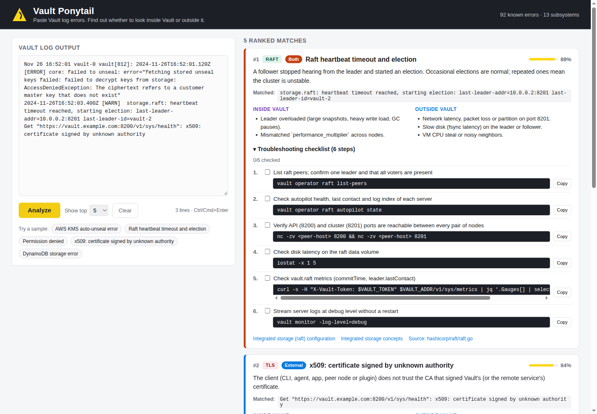

# Vault Ponytail

Paste HashiCorp Vault log errors and get ranked troubleshooting guidance that tells you **where to look**:
inside Vault (config, state, policy, usage) or outside it (storage backend, KMS/HSM, network, IAM, clients).

Everything runs in the browser. Nothing you paste leaves the page.



## Features

- Paste one or many lines straight from `journalctl`, the Vault server log, or CLI/API error output.
- A Vault version selector (1.15.x through the latest release) filters out matches for errors that do not
  exist in the selected version. Entries whose error string was introduced after 1.15 show a `v≥x.y` badge.
- Input is normalized before matching: ANSI color codes, syslog/journald prefixes, RFC 3339 timestamps,
  and hclog levels (`[ERROR]`, `level=error`) are stripped.
- Each match card shows:
  - the subsystem (`seal`, `raft`, `storage`, `tls`, `ha`, `token`, ...)
  - an **Internal / External / Both** indicator
  - a confidence score
  - the line that matched
  - likely causes inside and outside Vault
  - an ordered, checkable troubleshooting checklist with copyable commands
  - links to HashiCorp docs and to the Go source that emits the error
- Each match card ends with a **Related KB & docs** section: HashiCorp Vault Support KB articles
  (hosted on IBM Support at `ibm.com/support/pages/`) and official Vault documentation pages, ranked
  together for that error — with **KB** / **Docs** badges and conceptual guides preferred over raw API refs.
- If nothing matches, it shows generic triage: `vault status`, `sys/health`, `-log-level=debug`, audit logs,
  and storage health.

## Development

```bash
npm install
npm run dev      # http://localhost:5173/vault-ponytail/
npm test         # vitest: matcher + catalog validation
npm run build    # static site in dist/
```

Pushes to `main` run the tests, then deploy `dist/` to GitHub Pages
([.github/workflows/deploy.yml](.github/workflows/deploy.yml)).

## Project layout

```
index.html
vite.config.js
src/
  main.jsx
  App.jsx / App.css
  matcher.js              # normalization + scoring
  components/             # ResultCard, Checklist, NoMatch
  data/vault-errors.json  # the error catalog
tests/matcher.test.js
scripts/seed_catalog.py   # one-off generator used to seed the catalog from HashiCorp source
```

## How matching works

`analyze(text, { limit, minScore })` in [src/matcher.js](src/matcher.js):

1. Split input into lines and normalize each one: remove ANSI codes, timestamp prefixes and log levels.
2. For every catalog entry, test each `patterns` regex (case-insensitive) against every line.
3. Score each entry:
   - **Regex hits.** The base score is set by the most *specific* pattern that matched, measured by its number
     of literal words. So `permission denied as the entity on the token is disabled` beats
     `permission denied`. Additional matching patterns add a small bonus.
   - **Substring overlap.** This is the share of a pattern's words found anywhere in the input. It refines regex
     hits, and on its own lets close variants match at lower confidence.
   - **Logger affinity.** A bonus applies when the hclog logger name (`storage.raft:`, `expiration:`,
     `replication:`) matches the entry's subsystem.
   - **Root-cause position.** A small bonus goes to matches further right in a line, because Go error chains
     end with the root cause.
4. Return the top `limit` entries with `confidence` (0-100), `matchedPatterns` and `matchedLines`.

## Adding a catalog entry

Catalog entries live in [`src/data/vault-errors.json`](src/data/vault-errors.json) under `entries`.

```json
{
  "id": "storage-dynamodb",
  "title": "DynamoDB storage backend error",
  "subsystem": "storage",
  "location": "external",
  "patterns": [
    "ProvisionedThroughputExceededException",
    "dynamodb.*(AccessDeniedException|UnrecognizedClientException|ResourceNotFoundException)"
  ],
  "summary": "One sentence: what is broken and what the user sees.",
  "internal_causes": ["Causes inside Vault (config, state, policy)."],
  "external_causes": ["Causes outside Vault (backend, KMS/HSM, network, IAM)."],
  "troubleshooting_steps": [
    { "step": "What to check and why", "command": "vault status" },
    { "step": "A check without a command is fine too" }
  ],
  "references": [{ "title": "DynamoDB storage backend", "url": "https://developer.hashicorp.com/vault/docs/configuration/storage/dynamodb" }],
  "examples": ["A real log line that must match this entry first"],
  "source": { "repo": "hashicorp/vault", "path": "physical/dynamodb/dynamodb.go", "url": "https://github.com/hashicorp/vault/blob/main/physical/dynamodb/dynamodb.go" }
}
```

| Field | Rules |
|---|---|
| `versions` | Optional. `{"since": "1.19"}` when the error string did not exist before that minor version, `{"until": "1.18"}` when it was removed after it. Values are minor versions (`major.minor`) from the catalog's `vault_versions` list. Entries without `versions` apply to every supported version. |
| `id` | Unique, kebab-case, prefixed with the subsystem (`raft-join-failed`). |
| `subsystem` | One of `seal`, `raft`, `storage`, `tls`, `ha`, `network`, `token`, `auth`, `pki`, `transit`, `audit`, `identity`, `replication`. To add a new subsystem, also add it to `SUBSYSTEMS` in the test and give it a badge color in `App.css`. |
| `location` | `internal`, `external` or `both`. This drives the Internal / External / Both indicator. |
| `patterns` | JavaScript regex source strings, matched case-insensitively per line. Remember to escape backslashes in JSON (`"\\bbad token\\b"`). Prefer literal fragments copied from Vault source over loose wildcards. Put the most specific pattern first. |
| `internal_causes` / `external_causes` | Short, actionable sentences. Either array may be empty. |
| `troubleshooting_steps` | An ordered list. Start with the cheapest, least invasive check. Add `command` when there is something to run. |
| `references` | At least one link to HashiCorp docs or tutorials. Add a source link when you have one. |
| `examples` | At least one realistic log line or CLI error. **Tests require each example to rank this entry #1.** |
| `source` | Where the string is emitted: `repo`, `path`, `url`. Or use `{ "note": "..." }` for strings from Go stdlib, a cloud SDK, or Vault Enterprise. |

### Finding the real error string

```bash
git clone --depth 1 https://github.com/hashicorp/vault
cd vault
grep -rnE 'fmt\.Errorf|errwrap\.Wrapf|errors\.New|logger\.Error' vault/ builtin/ physical/ sdk/ command/ \
  --include='*.go' --exclude='*_test.go' | grep -i 'your error text'
```

Use the format string as your pattern and replace `%s`, `%q` and `%v` with `.*`. Many runtime errors are
wrapped, as in `failed to unseal: error="fetching stored unseal keys failed: ..."`. Match the most specific
fragment, not the generic wrapper.

### Verify

```bash
npm test
```

The catalog tests check that:

- the schema is valid
- every regex compiles
- ids are unique
- every example ranks its own entry first

If your new example ranks a different entry first, make your pattern more specific or narrow the competing
entry's pattern. Then add a case to the `analyze: real-world log lines` table in `tests/matcher.test.js` if the
scenario deserves explicit coverage.

### Article index (optional)

Related articles come from two static JSON indexes merged at runtime by `src/articles.js` (nothing is
fetched in the browser):

- `src/data/vault-kb-articles.json` — verified HashiCorp Vault Support Knowledge Base articles on
  `ibm.com/support/pages/` (migrated from the former `support.hashicorp.com`).
- `src/data/vault-articles.json` — official Vault documentation pages (~870 pages) generated from a
  sparse clone of `hashicorp/web-unified-docs` by `scripts/mine_articles.py`:

```
git clone --depth 1 --filter=blob:none --sparse https://github.com/hashicorp/web-unified-docs ~/web-docs
cd ~/web-docs && git sparse-checkout set content/vault/v2.x/content/docs content/vault/v2.x/content/api-docs
python3 scripts/mine_articles.py
```

### Version data (optional)

`scripts/mine_versions.py` re-checks every entry's probe string against the actual `hashicorp/vault`
source at the latest patch of each minor release (1.15 through current) and writes `versions` ranges
plus the top-level `vault_versions` list into the catalog. Because Vault sometimes moves an error to a
different file in a refactor, a probe missing at the oldest version is verified against the full 1.15
source tree before a `since` tag is written.

```
python3 scripts/mine_versions.py
```

### Re-seeding from source (optional)

The catalog was originally seeded by `scripts/seed_catalog.py`. That script contains the curated entries and
checks that each entry's `probe` literal exists in a non-test `.go` file of the HashiCorp clones, then records
the source link. The JSON is the source of truth now. Edit it directly unless you are rebuilding the catalog in
bulk, because re-running the script overwrites the JSON.
